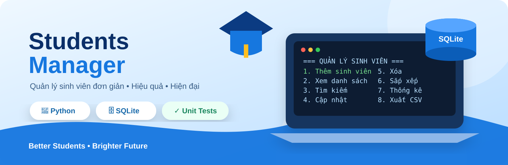

<div align="center">



</div>

# 🎓 Student Management System

<div align="center">

**Hệ thống quản lý sinh viên bằng Python • OOP • SQLite • Terminal**

[](https://www.python.org/)
[](https://www.sqlite.org/)
[](#-kiểm-thử)
[](#-giới-thiệu)

*Một project Python hướng đối tượng được xây dựng để thực hành quản lý dữ liệu, kiến trúc nhiều lớp, SQLite và kiểm thử tự động.*

</div>

---

## 📌 Giới thiệu

**Student Management System** là ứng dụng quản lý sinh viên chạy trên Terminal, được viết bằng **Python** theo mô hình hướng đối tượng (**OOP**).

Project tập trung vào việc xây dựng một chương trình có cấu trúc rõ ràng thay vì viết toàn bộ logic trong một file, đồng thời sử dụng **SQLite** để dữ liệu được lưu trữ lâu dài sau khi thoát chương trình.

### 🎯 Mục tiêu

- Thực hành lập trình Python theo hướng OOP.
- Làm quen với kiến trúc **Model → Repository → Service → UI**.
- Thực hành CRUD với SQLite.
- Rèn luyện kiểm tra và xử lý dữ liệu đầu vào.
- Viết **unit test** bằng thư viện `unittest`.
- Xuất dữ liệu sang CSV để sử dụng với Excel.

---

## ✨ Tính năng

| Chức năng | Mô tả |
|---|---|
| ➕ Thêm sinh viên | Thêm sinh viên mới với dữ liệu được kiểm tra hợp lệ |
| 📋 Xem danh sách | Hiển thị toàn bộ sinh viên trên Terminal |
| 🔎 Tìm kiếm | Tìm theo mã sinh viên hoặc họ tên |
| ✏️ Cập nhật | Chỉnh sửa thông tin sinh viên |
| 🗑️ Xóa | Xóa sinh viên khỏi hệ thống |
| 🔐 Kiểm tra dữ liệu | Chặn mã trùng, kiểm tra tuổi, điểm, giới tính và ngày sinh |
| 🏆 Xếp loại | Tự động xác định học lực dựa trên điểm trung bình |
| ↕️ Sắp xếp | Sắp xếp theo mã, họ tên, tuổi hoặc điểm |
| 📊 Thống kê | Thống kê số lượng, tuổi/điểm trung bình, cao nhất/thấp nhất và học lực |
| 💾 SQLite | Lưu dữ liệu lâu dài trong database |
| 📄 CSV | Xuất danh sách sinh viên sang CSV tương thích Excel |
| 🧪 Unit Test | Kiểm thử tự động bằng `unittest` |

---

## 🏆 Quy tắc xếp loại

| Điểm trung bình | Xếp loại |
|---:|---|
| `>= 9.0` | 🌟 Xuất sắc |
| `>= 8.0` | 🥇 Giỏi |
| `>= 6.5` | 🥈 Khá |
| `>= 5.0` | 📝 Trung bình |
| `>= 3.5` | ⚠️ Yếu |
| `< 3.5` | ❌ Kém |

---

## 🛠️ Công nghệ sử dụng

- 🐍 **Python 3.10+**
- 🗄️ **SQLite**
- 🧪 **unittest**
- 📄 **CSV**
- 💻 **Terminal / PowerShell**

> Không cần cài thêm thư viện bên ngoài.

---

## 📂 Cấu trúc project

```text
students_manager/
│
├── 📄 main.py
├── 📄 README.md
│
├── 📁 assets/
│   └── banner.svg
│
├── 📁 src/
│   ├── 📁 models/
│   │   └── student.py
│   ├── 📁 storage/
│   │   └── database.py
│   ├── 📁 repositories/
│   │   └── student_repository.py
│   ├── 📁 services/
│   │   └── student_manager.py
│   └── 📁 ui/
│       └── console.py
│
├── 📁 tests/
│   └── test_student_manager.py
│
├── 📁 data/
│   └── students.db
│
└── 📁 reports/
    └── students_report.csv
```

---

## 🧩 Kiến trúc chương trình

```text
                 ┌─────────────────┐
                 │      main.py    │
                 └────────┬────────┘
                          │
                          ▼
                 ┌─────────────────┐
                 │       UI        │
                 │    Console      │
                 └────────┬────────┘
                          │
                          ▼
                 ┌─────────────────┐
                 │     Service     │
                 │ StudentManager  │
                 └────────┬────────┘
                          │
                          ▼
                 ┌─────────────────┐
                 │   Repository    │
                 │ StudentRepo     │
                 └────────┬────────┘
                          │
                          ▼
                 ┌─────────────────┐
                 │    Database     │
                 │     SQLite      │
                 └─────────────────┘

                 Student Model
              ↙        ↓        ↘
          Validate   Classify   Data
```

### Vai trò từng tầng

- **Model** → `Student`: đại diện sinh viên, chuẩn hóa và kiểm tra dữ liệu.
- **Repository** → `StudentRepository`: thực hiện các thao tác SQL và CRUD.
- **Service** → `StudentManager`: xử lý nghiệp vụ, tìm kiếm, sắp xếp, thống kê và xuất CSV.
- **Database** → `Database`: khởi tạo schema và quản lý kết nối SQLite.
- **UI** → `Console`: giao tiếp với người dùng qua Terminal.

---

## 🚀 Cài đặt và chạy

### 1. Kiểm tra Python

Mở **PowerShell** tại thư mục project:

```powershell
python --version
```

Yêu cầu **Python 3.10 trở lên**.

### 2. Chạy chương trình

```powershell
python main.py
```

Database sẽ được tự động tạo tại:

```text
data/students.db
```

---

## 🧪 Kiểm thử

Project sử dụng `unittest` để kiểm tra các chức năng chính.

Chạy toàn bộ test:

```powershell
python -m unittest discover -s tests -v
```

Kết quả mong đợi:

```text
Ran 9 tests in ...s

OK
```

Các test bao gồm thêm, cập nhật, xóa, tìm kiếm, xếp loại, thống kê, kiểm tra dữ liệu và xuất CSV.

---

## 📊 Xuất báo cáo

Trong menu chương trình, chọn:

```text
8. Xuất báo cáo CSV
```

File báo cáo mặc định:

```text
reports/students_report.csv
```

File sử dụng **UTF-8 BOM**, giúp tiếng Việt hiển thị tốt khi mở bằng Microsoft Excel.

---

## 🖥️ Ví dụ giao diện

```text
╔══════════════════════════════════════════════╗
║        🎓 QUẢN LÝ SINH VIÊN                 ║
╠══════════════════════════════════════════════╣
║  1. Thêm sinh viên                          ║
║  2. Xem danh sách                           ║
║  3. Tìm kiếm                                ║
║  4. Cập nhật                                ║
║  5. Xóa sinh viên                           ║
║  6. Sắp xếp                                 ║
║  7. Thống kê                                ║
║  8. Xuất báo cáo CSV                        ║
║  0. Thoát                                   ║
╚══════════════════════════════════════════════╝
```

---

## 📚 Kiến thức áp dụng

Project giúp thực hành nhiều kiến thức quan trọng trong Python:

- `class` và đối tượng.
- Encapsulation và quản lý dữ liệu.
- Type hints.
- Exception handling.
- List, dictionary và xử lý dữ liệu.
- CRUD.
- SQL và SQLite.
- Context manager.
- Tổ chức project nhiều module.
- Unit testing.
- Làm việc với file CSV.
- Git và GitHub.

---

## 🔒 Lưu ý

Đây là **project học tập chạy cục bộ**. Project hiện chưa bao gồm:

- Đăng nhập người dùng.
- Phân quyền tài khoản.
- Đồng bộ dữ liệu nhiều máy.
- API / Web interface.

---

## 👨‍💻 Tác giả

<div align="center">

**Nguyễn Như Đức**

💻 IT Student • Python • OOP • Database

[](https://github.com/nguyennhuduc-dev)

</div>

---

<div align="center">

⭐ Nếu project hữu ích cho việc học tập, hãy **Star repository** nhé!

**Made with ❤️ and Python**

</div>
